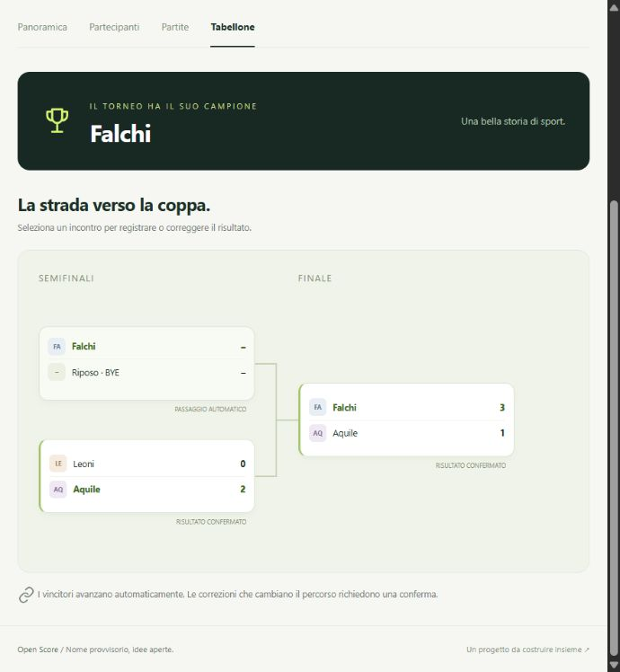

# Open Score

**Il tuo campo di gioco.** Un'applicazione originale per organizzare tornei sportivi a scuola: partecipanti, gironi, risultati e un percorso fino alla finale.

Progetto di **Leonardo Lalli e Maximiliam Cichello**, da discutere con il professore di scienze motorie. Nome e scelte di prodotto restano provvisori. La proposta iniziale è conservata in [docs/PROPOSTA_PROGETTO.md](docs/PROPOSTA_PROGETTO.md).

## Prova la demo

Richiede **Python 3.10 o successivo** e un browser moderno. Scarica la repository da **Code → Download ZIP**, estraila e apri PowerShell nella cartella `torneo-lab` contenuta al suo interno. In alternativa:

```powershell
git clone https://github.com/Leonardo-Lalli/Open-score.git
cd Open-score\torneo-lab
```

Poi esegui i comandi:

```powershell
py -m venv .venv
.venv\Scripts\Activate.ps1
python -m pip install -r requirements.txt
python -m uvicorn app:app --reload --host 127.0.0.1 --port 8000
```

Apri [http://127.0.0.1:8000](http://127.0.0.1:8000). Per fermare il server: **Ctrl+C**. Se PowerShell impedisce l'attivazione, puoi usare direttamente l'interprete, senza cambiare i criteri di sicurezza del sistema:

```powershell
.venv\Scripts\python.exe -m pip install -r requirements.txt
.venv\Scripts\python.exe -m uvicorn app:app --reload --host 127.0.0.1 --port 8000
```

Su macOS/Linux: `python3 -m venv .venv`, `source .venv/bin/activate`, poi gli stessi comandi `python`.

Al primo avvio serve un account docente. Impostare `TORNEO_ADMIN_EMAIL` e `TORNEO_ADMIN_PASSWORD` prima di avviare il server, oppure creare un account dalla cartella `torneo-lab` con `python manage.py create-teacher email@scuola.it --name "Nome"`. Senza account si può entrare come studente in sola lettura.

## Cosa mostrare al professore in cinque minuti

1. **Knockout Bracket of Football:** il caso fornito, Team #1 contro Team #2. Apri il tabellone e inserisci un risultato per proclamare il campione.
2. **Coppa della palestra:** otto squadre, quarti già iniziati, semifinali e finale collegate. I vincitori avanzano automaticamente.
3. **Campionato d'istituto:** sei squadre, calendario e classifica. Inserisci un risultato e osserva punti e partite giocate.
4. **Giornata dello sport:** sedici squadre in quattro gironi. Completati tutti i gironi, le prime due di ciascuno passano ai quarti.
5. **Sport e regole:** apri il catalogo, scegli Pallavolo 6v6 e mostra come la variante imposta durata, set e classifica; poi crea un torneo a 2 squadre e inserisci un risultato set per set.
6. **Nuovo torneo:** crea un knockout a tre partecipanti per mostrare il passaggio automatico per BYE. Il wizard raccoglie sport, variante, nomi e regole e mostra un riepilogo prima della creazione.

I quattro esempi vengono salvati al primo avvio. I nomi, gli incontri e i risultati si possono cambiare; i dati persistono dopo il riavvio. Non c'è una scadenza di 24 ore. Gli esempi aggiuntivi sono sintetici; il campione JSON fornito è conservato come fixture con i relativi ID di provenienza.

## Funzioni della versione 0.7.0

- Dashboard e interfaccia italiana responsive, procedura guidata, partecipanti rinominabili.
- Interfaccia unica SPA: le vecchie pagine mockup sono state rimosse e i relativi URL reindirizzano alla dashboard; gli asset sono versionati per evitare cache stantia.
- Ottimizzazione mobile iPhone/Android: safe area, viewport con notch, topbar sticky, drawer con scrim, touch target da 44 px, modali full-screen e input a 16 px.
- Ingresso con due scelte: **Sono un prof** (login email/password) e **Sono uno studente** (sola lettura). Gli studenti non possono creare, modificare o eliminare tornei né da UI né da API.
- Account docenti separati: ogni prof vede e gestisce solo i propri tornei; i tornei altrui restano leggibili ma non modificabili (403 lato API).
- Sei sport con sedici varianti: Calcio, Basket, Pallavolo, Badminton, Ping pong e Biliardino. Catalogo navigabile con schermate dedicate e link diretti alle regole.
- La variante determina composizione della squadra, durata, punteggio, classifica e regolamento; il torneo conserva uno snapshot delle regole scelte.
- La scheda squadra mostra giocatori in campo, lineup minima, rosa massima e giocatori mancanti; la pagina partecipanti riepiloga le rose pronte rispetto al minimo della variante.
- Rose dei giocatori con nome, numero di maglia e limite massimo della variante.
- Girone di sola andata o andata/ritorno, anche con numero dispari di partecipanti.
- Knockout da 2 a 32 partecipanti, seeding, BYE, tabellone effettivo e campione.
- Gironi uguali → qualificazione automatica delle prime 1/2 → eliminazione diretta.
- Risultati numerici o set per set: Pallavolo, Badminton e Ping pong validano set, punti, scarto e vittoria; la Pallavolo 6v6 assegna il bonus 2/1 al quinto set.
- Risultati e correzioni con controllo della versione, conferma per invalidare gli incontri dipendenti e storico delle modifiche.
- Data, ora, campo e durata inseriti manualmente, con durata predefinita dalla variante e controlli sui conflitti conosciuti.
- Esportazione CSV con dettaglio dei set e link alla vista spettatore di sola lettura, aggiornata ogni 30 secondi.
- Modifica del torneo, archiviazione e ripristino senza cancellare i dati; formato, sport e variante sono modificabili in bozza e si bloccano dopo la generazione degli incontri.
- I tornei di sport rimossi restano consultabili in sola lettura.
- Criterio a parità di punti configurabile: differenza reti, scontri diretti, reti fatte o vittorie.
- Scheda partecipante con girone, posizione, classifica, rosa e incontri.
- Accesso docenti con email e password, sessioni firmate, scritture protette, host della LAN ammessi e limite ai tentativi di accesso.
- Database SQLite persistente, backup consistenti, avvio automatico e API documentate.

**È un'applicazione per la LAN scolastica, non l'intera piattaforma del master prompt.** Non ci sono ruoli amministrativi oltre ai docenti, statistiche individuali, rigori, doppia eliminazione, Swiss, consolazione o scheduler automatico. Gli sport non più in catalogo restano leggibili solo per i tornei storici ma non sono selezionabili. I regolamenti delle varianti sono scelte della demo e vanno confermati con il professore.

Con `TORNEO_ADMIN_EMAIL` e `TORNEO_ADMIN_PASSWORD` viene creato il primo account docente; altri account si aggiungono con `python manage.py create-teacher`. Chi non accede resta in sola lettura, come gli studenti. Ogni docente può gestire solo i tornei della propria utenza; il link spettatore è di sola lettura. Il server può essere raggiunto dalla LAN, ma non è destinato a Internet: installazione, firewall, backup e limiti sono in [DEPLOY.md](docs/DEPLOY.md) e [SECURITY.md](docs/SECURITY.md).

## Hosting sulla LAN scolastica

La webapp va installata su **un solo computer** della scuola e usata dagli altri dispositivi tramite l'indirizzo IP del server nella rete interna. Non va pubblicata su Internet. Servono Python 3.10 o successivo, un indirizzo IP fisso o prenotato nel router e l'accesso amministratore solo per aprire la porta e installare l'avvio automatico.

### 1. Preparare il server

Copiare la repository sul computer, per esempio in `C:\OpenScore`, poi creare l'ambiente e installare le dipendenze:

```powershell
cd C:\OpenScore\torneo-lab
py -m venv .venv
.venv\Scripts\python.exe -m pip install -r requirements.txt
```

### 2. Configurare password e indirizzi ammessi

```powershell
cd C:\OpenScore
Copy-Item deploy\open-score.env.example deploy\open-score.env
notepad deploy\open-score.env
```

Nel file impostare almeno l'account del primo docente e gli indirizzi con cui il server viene raggiunto:

```text
TORNEO_ADMIN_EMAIL=prof@scuola.it
TORNEO_ADMIN_PASSWORD=una-password-lunga-e-condivisa
TORNEO_ALLOWED_HOSTS=192.168.1.50,open-score.local
```

Sostituire `192.168.1.50` con l'IP reale del server e aggiungere il nome del computer solo se lo si usa. `127.0.0.1` e `localhost` sono sempre ammessi. Il file `deploy/open-score.env` contiene segreti e non va condiviso né caricato su Git.

Per creare gli altri account docente:

```powershell
cd C:\OpenScore\torneo-lab
.\.venv\Scripts\python.exe manage.py create-teacher altro.prof@scuola.it --name "Nome Cognome"
.\.venv\Scripts\python.exe manage.py list-teachers
```

Per reimpostare una password usare `manage.py reset-password <email>`.

### 3. Aprire la porta nel firewall

Da PowerShell come amministratore, sulla rete privata:

```powershell
New-NetFirewallRule -DisplayName "Open Score" -Direction Inbound `
  -Protocol TCP -LocalPort 8000 -Action Allow -Profile Private
```

### 4. Avviare e verificare l'accesso

```powershell
powershell -ExecutionPolicy Bypass -File C:\OpenScore\deploy\start-open-score.ps1
```

Il server ascolta su `0.0.0.0:8000` con un solo processo `uvicorn`: SQLite serializza già le scritture e più worker non sono necessari. Dal computer server aprire `http://127.0.0.1:8000`; da un altro dispositivo della stessa rete aprire `http://192.168.1.50:8000` con l'IP reale. Verificare che **Accedi** chieda la password e che **Nuovo torneo** compaia solo dopo l'accesso.

Se compare `Invalid host header`, l'indirizzo usato non è presente in `TORNEO_ALLOWED_HOSTS`. Per fermare un avvio manuale usare **Ctrl+C**.

### 5. Avvio automatico e backup

Da PowerShell come amministratore:

```powershell
powershell -ExecutionPolicy Bypass -File C:\OpenScore\deploy\install-windows-task.ps1
```

Lo script registra l'avvio del server all'accensione del computer e un backup giornaliero alle 18:30. Un backup manuale si esegue con:

```powershell
powershell -ExecutionPolicy Bypass -File C:\OpenScore\deploy\backup-open-score.ps1
```

I backup finiscono in `torneo-lab\backup\`; copiarli periodicamente su un secondo disco o su una cartella di rete. Per Linux/systemd, aggiornamenti, ripristino e lista di controllo completa seguire [DEPLOY.md](docs/DEPLOY.md).

## Verifica e documentazione

Dalla cartella `torneo-lab`:

```powershell
python -m pip install -r requirements-dev.txt
python -m pytest -q
```

Sono verificati algoritmi, avanzamenti, multifase, correzioni, concorrenza, persistenza, validazioni, CSV, API, autenticazione, host della LAN e backup. Risultati ed esatta copertura nel [report dei test](docs/TEST_REPORT.md). Documentazione interattiva: [localhost:8000/docs](http://127.0.0.1:8000/docs).

| Documento | Contenuto |
| --- | --- |
| [Proposta per il professore](docs/PROPOSTA_PROGETTO.md) | Introduzione originale e obiettivi scolastici |
| [Audit](docs/AUDIT.md) | Cosa conteneva lo ZIP e cosa è stato migliorato |
| [Analisi dei riferimenti](docs/REFERENCE_ANALYSIS.md) | Screenshot, JSON, fonti e limiti delle inferenze |
| [Matrice funzionale](docs/FEATURE_MATRIX.md) | Funzioni presenti, verificate e rimandate |
| [Schede funzionali](docs/FUNCTIONAL_SPECS.md) | Input, regole, dati, stati e casi limite |
| [Architettura](docs/ARCHITECTURE.md) · [Database](docs/DATABASE.md) · [API](docs/API.md) | Struttura effettiva dell'applicazione |
| [Deploy in LAN](docs/DEPLOY.md) · [Sicurezza](docs/SECURITY.md) | Installazione, firewall, backup, ripristino, credenziali e limiti |
| [Piano di sviluppo](docs/DEVELOPMENT_PLAN.md) · [Decisioni](docs/DECISIONS.md) | Passi successivi e ipotesi da discutere |
| [Changelog](docs/CHANGELOG.md) | Incrementi 0.4 → 0.7 |

Il codice è originale e non dipende dai server di Score7. La licenza per il rilascio open source stabile va concordata tra gli autori; non è ancora stata assegnata. Database, credenziali e ambienti locali non sono inclusi nella repository.

## Anteprima reale

Tabellone della prova eseguita dal browser, dopo inserimento e correzione dei risultati:


