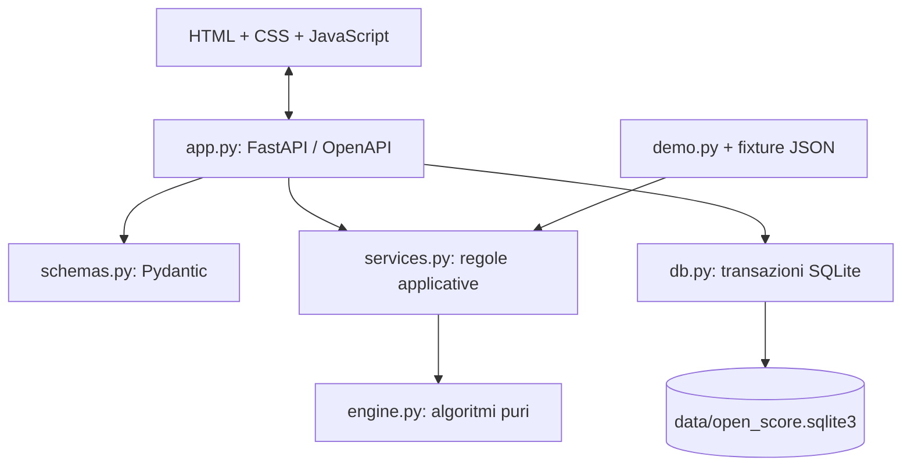

# Architettura della demo 0.2

Questa è l'architettura originale di Open Score, non l'architettura interna di Score7.

## Responsabilità

- `torneo-lab/app.py`: application factory, endpoint, file statici, controllo Host/Origin, CSV.
- `schemas.py`: contratti in ingresso, limiti, nomi ripuliti, punteggi interi rigorosi.
- `services.py`: creazione, generazione, qualificazioni, avanzamenti, correzioni, calendario e diario.
- `engine.py`: metodo del cerchio per i gironi, albero knockout con seeding e BYE, classifica derivata.
- `db.py` e `migrations/001_initial.sql`: schema versionato e transazione per operazione.
- `demo.py`: quattro esempi persistenti e caricamento idempotente. Nessuna richiesta a Score7.
- `static/`: interfaccia italiana responsive, finestre native `dialog`, tabellone SVG/HTML con collegamenti reali.

## Una modifica attraversa il sistema

Il browser invia punteggio e `version`. La transazione acquisisce il lock SQLite prima della lettura. Il servizio verifica torneo, incontro, versione e avversari; salva il risultato e lo storico, invalida eventuali dipendenze con conferma e propaga i vincitori. Solo dopo il commit il browser rilegge i dati. Non mostra un salvataggio riuscito se il server lo rifiuta.

Il tabellone esiste interamente dalla generazione: gli incontri futuri hanno riferimenti `source_home`/`source_away`, non squadre inventate. Un BYE non è uno 0–0 e non conta tra le partite giocate. Se cambia il vincitore, tutti gli incontri discendenti perdono risultati e programmazione; i rami indipendenti restano intatti.

Nei tornei multifase, tutte le partite dei gironi devono essere complete prima di creare i knockout. Le prime 1 o 2 di ciascun girone vengono ordinate per posizione e girone, poi distribuite dal seeding standard. Correggere un girone dopo la qualificazione richiede conferma e ricostruisce la fase finale; lo storico precedente resta nel diario.

## Confine di questa consegna

È un'applicazione per un solo spazio di lavoro, ora utilizzabile sulla LAN scolastica. La pagina spettatore e il suo endpoint sono di sola lettura. Con `TORNEO_ADMIN_PASSWORD` (o `TORNEO_API_TOKEN`) tutte le scritture richiedono la sessione dell'organizzatore: esiste un solo ruolo amministrativo condiviso, non account individuali né permessi per torneo. Senza password l'app resta in modalità demo locale su `127.0.0.1`. Il server può ascoltare sulla LAN, ma non è destinato a Internet; installazione, host ammessi e backup sono descritti in [DEPLOY.md](DEPLOY.md) e [SECURITY.md](SECURITY.md).

Frontend senza build e SQLite riducono i passaggi per presentarla a scuola. React/TypeScript, SQLAlchemy/Alembic e PostgreSQL restano opzioni per la piattaforma successiva; account individuali e ruoli per torneo richiederebbero un modello utenti che questa versione non ha.
