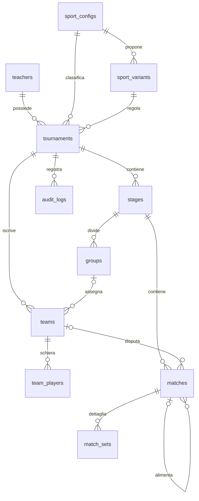

# Database e conservazione dei dati

Default: `torneo-lab/data/open_score.sqlite3`. Percorso configurabile con `TORNEO_DB_PATH`. Il file, i database di test e l'ambiente Python sono esclusi da Git. Il database parte vuoto: non vengono creati tornei dimostrativi e l'app mostra solo i dati inseriti dagli utenti.

## Schema effettivo (versione 7)

| Tabella | Chiave e relazioni | Dati e vincoli principali |
| --- | --- | --- |
| teachers | PK id; email unica (case-insensitive) | Account docente: email, hash PBKDF2-SHA256 della password, nome visualizzato e data di creazione |
| sport_configs | PK id; nome unico | Sport padre del catalogo: nome, descrizione, sistema di punteggio, regole JSON e `sort_order` |
| sport_variants | PK id; FK sport_configs; slug unico; UNIQUE(sport, nome) | Varianti selezionabili: descrizione, tipo team/individual, ordine, regole JSON e regolamento testuale |
| tournaments | PK id; FK sport_configs, sport_variants e teachers; public_token unico | Formato enumerato, nome non vuoto, sport testuale e `sport_id`, variante e `variant_id`, `teacher_id` proprietario (NULL per tornei storici), snapshot di regole e regolamento, tipo team/individual, regole dei punti, gironi e qualificate, andata/ritorno, seed, tipo torneo, sistema di punteggio, `archived_at`, `updated_at`, `tie_breaker`; `demo_key` è una colonna legacy non più popolata |
| stages | PK id; FK torneo; UNIQUE(torneo,ordinal) | Una fase round_robin o knockout; source_id opzionale per provenienza |
| groups | PK id; FK fase; UNIQUE(fase,nome) | Gironi della prima fase |
| teams | PK id; FK torneo e girone opzionale; UNIQUE(torneo,nome) | Partecipanti; il tipo squadra/individuale è definito dalla variante; source_id opzionale |
| team_players | PK id; FK teams; UNIQUE(team,nome) | Rosa: nome e numero di maglia opzionale 0–99; eliminazione a cascata con la squadra |
| matches | PK id; FK torneo, fase, girone, partecipanti, vincitore e incontri sorgente | Turno e posizione unici per fase, punteggi entrambi NULL o entrambi interi 0–999, avversari diversi, BYE, versione, programmazione |
| match_sets | PK id; FK matches; UNIQUE(match,set_no) | Punti casa/ospite per ogni set, da 1 a 7 set; eliminazione a cascata con l'incontro |
| audit_logs | PK id; FK torneo | Azione, timestamp UTC e snapshot JSON delle modifiche o degli incontri invalidati |

Catalogo canonico in `sport_configs`, in ordine di `sort_order`: **Calcio, Basket, Pallavolo, Badminton, Ping pong, Biliardino**. Le sedici varianti in `sport_variants` sono: Calcio a 11/a 7/a 5, Basket 5v5/3x3, Pallavolo 6v6/4v4/beach 2v2, Badminton singolare/doppio/doppio misto, Ping pong singolare/doppio/doppio misto, Biliardino singolare/doppio. Pallamano e Tennis sono stati rimossi dal catalogo: i tornei che li citano conservano nome e dati, hanno `sport_id`/`variant_id` NULL e sono di sola lettura. Calcio a 5 non è più uno sport separato: la migrazione lo rimappa alla variante `calcio-a-5`. Il server risolve `sport_id` dal nome e rifiuta con 422 una coppia sport/`sport_id` o sport/variante incoerente.

Il regolamento e le regole della variante vengono copiati in `tournaments.rules_snapshot` e `regulation_snapshot` alla creazione. Modificare il catalogo non riscrive quindi i tornei già creati. `variant_id` collega il torneo alla variante corrente; `variant` conserva lo slug come snapshot leggibile.

Indici su incontri/torneo/fase/turno, partecipanti/torneo, `tournaments(sport_id)`, `tournaments(teacher_id, id)`, `sport_variants(sport_id, sort_order)`, `team_players(team_id)`, `match_sets(match_id)` e `teachers(email)`. Su ogni connessione: `PRAGMA foreign_keys=ON`, `busy_timeout=10000`, `journal_mode=WAL`. I nomi duplicati vengono controllati anche con `casefold()` nel servizio. La classifica non è una tabella: viene ricalcolata dai risultati validi, evitando copie divergenti. Il criterio a parità di punti è memorizzato in `tournaments.tie_breaker` con un `CHECK` sui quattro valori ammessi; `head_to_head` costruisce una mini-classifica dei soli scontri diretti tra le squadre appaiate.



`teams` è il nome tecnico conservato per continuità con lo starter. Le rose sono normalizzate in `team_players`; non esistono ancora organizzazioni né persone condivise tra più squadre. Gli ID del campione fornito sono memorizzati come `source_id`, senza usarli come chiavi locali.

## Transazioni, orari e modifiche

Ogni scrittura usa `BEGIN IMMEDIATE`: controlli e aggiornamenti sono atomici e serializzati. Un client che invia una versione precedente riceve 409. Tutte le correzioni sono validate prima del commit; in caso di errore viene eseguito rollback. I risultati rimossi dai knockout sono conservati negli snapshot di audit.

Timestamp di creazione e programmazione in UTC; la UI mostra gli incontri in `Europe/Rome`. Il modulo di inserimento usa il fuso del dispositivo e invia un ISO 8601 con offset. Sovrapposizioni di campo/partecipanti conosciuti e dipendenze con orari già assegnati sono controllate. Nessuna garanzia di pianificazione globale per avversari ancora sconosciuti.

Non è esposta la cancellazione dei tornei: si archiviano con `archived_at` e si ripristinano. Un torneo archiviato resta leggibile ma rifiuta ogni scrittura (409). Lo stesso vale per un torneo con sport storico rimosso (`sport_id` o `variant_id` NULL). Le squadre si possono rimuovere solo prima della generazione; i giocatori si aggiungono e rimuovono anche a torneo generato, rispettando il massimo della variante. Gli ID degli incontri non vengono riutilizzati dopo una rigenerazione, così una richiesta obsoleta non può colpire un incontro nuovo. Le FK impediscono la rimozione accidentale di nodi ancora referenziati. Le invalidazioni eliminano i knockout dall'ultimo turno al primo e salvano prima gli snapshot.

`updated_at` viene aggiornato a ogni modifica del torneo. Formato, sport, variante, regole, gironi e qualificazioni sono modificabili solo in bozza: dopo la generazione il server risponde 409. Nome e descrizione restano sempre modificabili. La durata degli incontri generati e la durata predefinita della programmazione derivano da `rules_snapshot.match_duration`.

## Migrazioni e backup

`migrations/001_initial.sql`, `002_stable_match_ids.sql`, `003_sports_expansion.sql`, `004_archive_and_updates.sql`, `005_tie_breaker.sql`, `006_sport_variants.sql` e `PRAGMA user_version=6` definiscono la baseline corrente. La migrazione 006 crea catalogo e varianti, rimappa Calcio a 5, azzera i riferimenti agli sport rimossi, adotta la variante predefinita per i tornei esistenti, copia gli snapshot e crea `team_players` e `match_sets`. Il runner in `db.py` applica le migrazioni mancanti in ordine e aggiorna la versione; un database più recente del programma viene rifiutato. Il database originale dello starter (`tornei.sqlite3`) non viene modificato. Puntando a un database legacy senza versione l'app si ferma con un errore esplicito: non tenta conversioni distruttive. Un importatore legacy resta nel piano di sviluppo.

SQLite in modalità WAL è la scelta per la LAN scolastica: un solo processo `uvicorn` (un worker), scritture serializzate con `BEGIN IMMEDIATE` e letture concorrenti. PostgreSQL richiederà una migrazione dedicata, non il semplice cambio di percorso, e sarà valutato solo se serviranno più server o molte scritture simultanee.

Per un backup consistente usare l'API SQLite (`VACUUM INTO` o `sqlite3.Connection.backup`) invece di copiare il file a caldo: con WAL il file principale da solo può essere incompleto. `backup.py` usa `VACUUM INTO` e produce `backup/open_score-AAAAMMGG-HHMMSS-microsecondi.sqlite3`, con conservazione configurabile:

```powershell
.venv\Scripts\python.exe backup.py --keep 14
```

Il backup è eseguibile mentre il server scrive, perché `VACUUM INTO` legge uno snapshot transazionale. Il file prodotto è un database SQLite completo e autonomo: non servono `-wal` o `-shm`. Su Windows lo script `deploy/backup-open-score.ps1` aggiunge data, esito e percorso a `backup/backup.log`. Per ripristinare: fermare il server, spostare `data/open_score.sqlite3` e i file `-wal`/`-shm`, copiare il backup come `data/open_score.sqlite3`, riavviare. I backup contengono tutti i dati e non vanno pubblicati su GitHub né lasciati senza protezione.

## Segreto delle sessioni

Quando l'autenticazione è attiva, i cookie sono firmati con HMAC-SHA256. Il segreto si legge da `TORNEO_SECRET`; se assente, `auth.py` crea `data/session.secret` con permessi ristretti e lo riusa ai successivi avvii. Cancellare o sostituire quel file invalida tutte le sessioni esistenti, senza toccare i tornei. Il segreto non è nel database: un backup del solo `.sqlite3` non contiene cookie validi, mentre serve il file del segreto per continuare le sessioni dopo un ripristino su un altro computer. Sia il database sia il segreto sono esclusi da Git.
