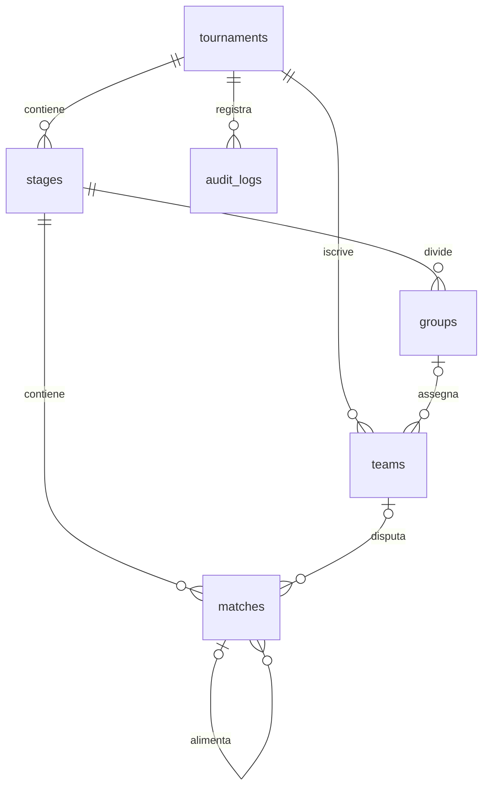

# Database e conservazione dei dati

## Schema corrente 4 — backend 0.3

Le tabelle della demo descritte sotto sono conservate. La migrazione
`003_core_platform.sql` aggiunge organizations/users, sessions, auth_attempts,
tournament_collaborators, students, invites, enrollments, result_proposals,
official_results, result_reviews, venues, fields e administrative_audit.
Le nuove colonne collegano tornei a owner/contesto/regole/pubblicazione/versioni,
squadre a ordine/capienza/archiviazione, incontri a campo/timezone/score JSON,
audit a un autore. `004_team_penalties.sql` aggiunge penalità persistenti con ragione.

Foreign key, indici di ricerca, unicità utenti/membership/token e vincoli di stato
sono nelle migrazioni. Sessioni/inviti salvano hash dei token, password con hash
salato; nessun dato reale nei test. Le API verificano inoltre appartenenza delle
FK al torneo/contesto, capienza e versioni prima della scrittura atomica.

Le proposte restano distinte dai risultati. official_results rappresenta lo
stato corrente; result_reviews e audit conservano le revisioni. Quando una finale
viene ricostruita, le proposte conservano original_match_id e perdono la FK live
(ON DELETE SET NULL); lo storico mantiene l'ID originale senza una FK che
impedisca la ricostruzione. I risultati correnti dei nodi eliminati sono rimossi,
i precedenti snapshot restano nell'audit. Il risultato aggregato in matches è
usato dal motore; score_json conserva i singoli set. Classifiche sempre derivate.

Ogni aggiornamento da schema precedente crea prima una copia SQLite consistente
pre-v4 con timestamp. L'inizializzatore chiude esplicitamente la connessione.
Nessuna assegnazione automatica dei tornei al primo utente: owner resta null.
La CLI claim valida un preset esplicito e conserva ID/punteggi; approvatore legacy
non inventato. DB senza versione non vuoto e schema futuro sono rifiutati.
I backup contengono dati privati e restano esclusi da Git.

I test verificano 1/2→4, FK, riapertura, backup e ripristino su nuovo file senza
sovrascrivere l'originale. PostgreSQL non è implementato: richiede adapter SQL e
migrazioni specifiche. Procedura operativa in [DEPLOYMENT_BACKEND](DEPLOYMENT_BACKEND.md).

## Baseline storica 0.2

Default: `torneo-lab/data/open_score.sqlite3`. Percorso configurabile con `TORNEO_DB_PATH`. Il file, i database di test e l'ambiente Python sono esclusi da Git. I quattro esempi vengono creati al primo avvio di un database nuovo. `POST /api/demo` aggiunge gli esempi mancanti senza azzerare i risultati esistenti.

## Schema effettivo

| Tabella | Chiave e relazioni | Dati e vincoli principali |
| --- | --- | --- |
| tournaments | PK id; public_token e demo_key unici | Formato enumerato, nome non vuoto, sport, tipo team/individual, regole dei punti, numero gironi e qualificate, andata/ritorno, seed |
| stages | PK id; FK torneo; UNIQUE(torneo,ordinal) | Una fase round_robin o knockout; source_id opzionale per provenienza |
| groups | PK id; FK fase; UNIQUE(fase,nome) | Gironi della prima fase |
| teams | PK id; FK torneo e girone opzionale; UNIQUE(torneo,nome) | Partecipanti; il tipo squadra/individuale è definito sul torneo; source_id opzionale |
| matches | PK id; FK torneo, fase, girone, partecipanti, vincitore e incontri sorgente | Turno e posizione unici per fase, punteggi entrambi NULL o entrambi interi 0–999, avversari diversi, BYE, versione, programmazione |
| audit_logs | PK id; FK torneo | Azione, timestamp UTC e snapshot JSON delle modifiche o degli incontri invalidati |

Indici su incontri/torneo/fase/turno e partecipanti/torneo. `PRAGMA foreign_keys=ON` su ogni connessione. I nomi duplicati vengono controllati anche con `casefold()` nel servizio. La classifica non è una tabella: viene ricalcolata dai risultati validi, evitando copie divergenti.

`teams` è il nome tecnico conservato per continuità con lo starter; non esistono ancora rose, giocatori appartenenti alle squadre o organizzazioni. Gli ID del campione fornito sono memorizzati come `source_id`, senza usarli come chiavi locali.

## Transazioni, orari e modifiche

Ogni scrittura usa `BEGIN IMMEDIATE`: controlli e aggiornamenti sono atomici e serializzati. Un client che invia una versione precedente riceve 409. Tutte le correzioni sono validate prima del commit; in caso di errore viene eseguito rollback. I risultati rimossi dai knockout sono conservati negli snapshot di audit.

Timestamp di creazione e programmazione in UTC; la UI mostra gli incontri in `Europe/Rome`. Il modulo di inserimento usa il fuso del dispositivo e invia un ISO 8601 con offset. Sovrapposizioni di campo/partecipanti conosciuti e dipendenze con orari già assegnati sono controllate. Nessuna garanzia di pianificazione globale per avversari ancora sconosciuti.

Non è esposta la cancellazione dei tornei. Le squadre si possono rimuovere solo prima della generazione. Gli ID degli incontri non vengono riutilizzati dopo una rigenerazione, così una richiesta obsoleta non può colpire un incontro nuovo. Le FK impediscono la rimozione accidentale di nodi ancora referenziati. Le invalidazioni eliminano i knockout dall'ultimo turno al primo e salvano prima gli snapshot.

## Migrazioni e backup

`migrations/001_initial.sql`, `002_stable_match_ids.sql` e `PRAGMA user_version=2` definiscono la nuova baseline. Il database originale dello starter (`tornei.sqlite3`) non viene modificato. Non erano presenti dati applicativi da migrare nella cartella iniziale. Puntando a un database legacy senza versione l'app si ferma con un errore esplicito: non tenta conversioni distruttive. Un importatore legacy e le migrazioni incrementali di produzione restano nel piano di sviluppo.

Per un backup locale, arrestare il server e copiare `data/open_score.sqlite3`; per ripristinarlo, arrestare il server e usare la copia attraverso `TORNEO_DB_PATH`. Il backup non va pubblicato su GitHub. PostgreSQL richiederà una migrazione dedicata, non il semplice cambio di percorso.
