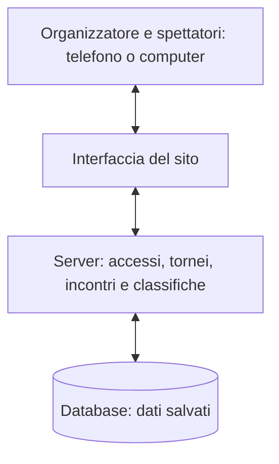

> Documento iniziale conservato per il confronto con il professore. La demo successiva e le istruzioni attuali sono descritte nel [README principale](../README.md).

# Open Score — proposta di progetto

**Un sito open source per organizzare gironi e tornei sportivi.**

> Bozza per il confronto con il professore di scienze motorie e il gruppo di lavoro — 24 ottobre 2026. Nome, funzionalità, tecnologie e tempi sono proposte modificabili.

**Gruppo iniziale:** Leonardo Lalli e Maximiliam Cichello, con possibilità di coinvolgere altre persone.

**Repository:** [Leonardo-Lalli/Open-score](https://github.com/Leonardo-Lalli/Open-score).

**Stato attuale:** proposta iniziale; l'applicazione deve ancora essere sviluppata.

## 1. L'idea e la sua utilità a scuola

Vogliamo realizzare un sito che aiuti a organizzare un torneo: inserire le squadre, creare gli incontri, registrare i risultati e ottenere una classifica aggiornata. Dovrà essere utilizzabile anche dal telefono, per consultarlo e aggiornarlo durante le attività in palestra.

Il professore potrà aiutarci a definire le regole e a verificare che il sito risponda a esigenze reali: tempo a disposizione, numero di squadre, campi disponibili e criteri di classifica comprensibili a tutti. Il progetto unisce così programmazione, organizzazione sportiva e collaborazione.

**Esempio di primo utilizzo:** quattro squadre giocano un girone di sola andata. Il sito prepara le sei partite; l'organizzatore inserisce i risultati e tutti possono consultare calendario e classifica da un link.

L'obiettivo generale è supportare più sport, ma partiremo da uno solo, da scegliere insieme: per esempio calcio a 5. La pallavolo potrebbe essere un passo successivo, perché richiede la gestione dei set e regole di classifica diverse.

## 2. Il riferimento: cosa possiamo imparare da Score7

Abbiamo preso come riferimento [Score7](https://www.score7.io/it), che presenta strumenti per diversi formati di torneo, gestione degli incontri e condivisione dei risultati.

Questa prima analisi è un **reverse engineering funzionale**: osserviamo le schermate e le funzioni pubbliche per capire quali problemi risolvono. Sono stati consultati il sito, le pagine descrittive e una demo pubblica, compresa la finestra iniziale di creazione. Non è stato completato un torneo di prova né verificata l'area riservata. Codice, database e architettura interna di Score7 non sono noti: l'architettura della sezione 4 è una nostra proposta. Interfaccia, testi e codice di Open Score saranno originali.

| Aspetto | Cosa emerge dall'analisi pubblica | Come usarlo nel nostro progetto |
| --- | --- | --- |
| Configurazione | La finestra iniziale permette di scegliere sport, numero di partecipanti e formato. | Un percorso breve per impostare il torneo. |
| Gironi e classifica | La demo mostra partite giocate, vittorie, pareggi, sconfitte, gol e punti, con criteri di spareggio dichiarati. | Regole visibili e classifica calcolata dai risultati. |
| Formati | Il sito presenta campionati, eliminazione diretta e tornei con più fasi. | Prima i gironi; poi tabelloni e collegamento tra le fasi. |
| Calendario | Le pagine descrivono assegnazione di date e campi, anche automatica. | Prima inserimento manuale degli orari; pianificazione automatica in seguito. |
| Consultazione | La demo è consultabile senza account. | Una pagina di sola lettura da condividere con i partecipanti. |

Riferimenti: [demo del campionato](https://www.score7.io/tournaments/demo-kestrel-valley-league), [girone all'italiana e classifiche](https://www.score7.io/it/campionati), [gestione del calendario](https://www.score7.io/it/gestione-calendario-partite). Le funzioni descritte dal sito non sono tutte state provate direttamente.

## 3. La prima versione utilizzabile

La prima versione, chiamata anche **MVP**, deve permettere di svolgere un piccolo torneo completo a gironi.

1. Creare un torneo e scegliere le regole dello sport iniziale.
2. Inserire le squadre e assegnarle a uno o più gironi.
3. Generare gli incontri di sola andata: ogni squadra affronta tutte le altre del proprio girone una volta.
4. Assegnare manualmente data, orario e campo, quando necessari.
5. Inserire e correggere i risultati, aggiornando automaticamente la classifica.
6. Salvare i dati e consultare calendario e classifica da una pagina condivisibile.

L'organizzatore avrà un accesso protetto per modificare il torneo; gli spettatori potranno soltanto leggerlo. Per la prima prova useremo nomi di squadre, senza richiedere schede personali degli studenti.

**La prima versione sarà pronta quando** il torneo di quattro squadre potrà essere creato, completato, corretto e riaperto senza perdere dati, anche da telefono. La classifica dovrà coincidere con un calcolo verificato a mano e uno spettatore non dovrà poter modificare i risultati.

Le fasi successive aggiungeranno eliminazione diretta, passaggio dai gironi alle finali e un secondo sport. Funzioni come statistiche individuali, iscrizioni autonome, notifiche e pianificazione automatica resteranno fuori dalla prima versione.

## 4. Come potrebbe essere costruita l'applicazione

Proponiamo **un'unica applicazione web**, con tre parti distinte per responsabilità. Per un gruppo iniziale di due persone questa struttura permette di lavorare insieme senza dover gestire molti servizi separati.

| Parte | Spiegazione e compito |
| --- | --- |
| Interfaccia, o frontend | Le schermate usate dalle persone: creazione, squadre, calendario, risultati e classifica. Dovrà essere leggibile da telefono e semplice da usare. |
| Server, o backend | Controlla chi può modificare i dati, verifica i risultati, genera gli incontri e calcola la classifica. |
| Database | Conserva tornei, squadre, partite, risultati e impostazioni, anche dopo la chiusura del browser. |

**Come passa un risultato nel sistema:** l'organizzatore lo inserisce → il server verifica accesso e punteggio → lo salva → ricalcola la classifica → il sito mostra i dati aggiornati. Per iniziare, gli spettatori potranno aggiornare la pagina; l'aggiornamento in tempo reale potrà arrivare dopo.

I dati principali saranno:

- **Torneo:** nome, sport, organizzatore e regole.
- **Fase e girone:** struttura della competizione e squadre assegnate; in seguito anche fase finale.
- **Partecipante:** inizialmente una squadra, con possibilità futura di gestire singoli giocatori o coppie.
- **Partita:** avversari, girone o turno, eventuale orario e campo, stato e risultato.

La classifica sarà ricavata dai risultati confermati. Una partita ancora da giocare non dovrà essere contata come uno 0–0. Separare le regole dello sport dalla generazione degli incontri ci permetterà di riutilizzare i gironi anche quando aggiungeremo i set della pallavolo.

**Tecnologie da valutare insieme:** una possibilità è usare TypeScript e [Next.js](https://nextjs.org/docs), che permette di sviluppare interfaccia e funzioni server nello stesso progetto, con [PostgreSQL](https://www.postgresql.org/about/) per conservare i dati. La scelta dipenderà soprattutto dalle competenze del gruppo.

GitHub ospiterà codice e documentazione. Per utilizzare online l'applicazione con dati condivisi servirà anche un servizio che esegua il server e ospiti il database. [GitHub Pages](https://docs.github.com/en/pages/getting-started-with-github-pages/what-is-github-pages) ospita siti statici: potrà servire per una presentazione o demo statica, mentre l'architettura proposta richiede anche un backend. Hosting, eventuali costi e licenza open source saranno scelti prima della pubblicazione della prima versione.

## 5. Roadmap proposta

Le tappe indicano l'ordine del lavoro. Le durate saranno concordate dopo aver verificato competenze, disponibilità e impegni scolastici.

| Tappa | Cosa fare | Risultato da mostrare |
| --- | --- | --- |
| 1. Confronto iniziale | Discutere questa proposta; scegliere primo sport, regole, dimensioni del torneo e responsabilità. | Un elenco breve di requisiti condivisi con amico e professore. |
| 2. Prototipo delle schermate | Disegnare creazione, squadre, calendario e classifica con dati inventati. | Un percorso visibile da commentare prima di sviluppare la logica. |
| 3. Motore dei gironi | Generare gli incontri e calcolare la classifica, verificando anche squadre dispari e parità di punti. | Esempi corretti e controlli automatici sulle regole principali. |
| 4. Prima versione completa | Collegare schermate, server e database; aggiungere accesso organizzatore e pagina pubblica. | Il piccolo torneo della sezione 3 utilizzabile dall'inizio alla fine. |
| 5. Prova e pubblicazione | Simulare un torneo con il professore, correggere i problemi, documentare installazione e uso; scegliere licenza e hosting. | Prima versione pubblicata e istruzioni per chi vuole usarla o contribuire. |
| 6. Evoluzione | Aggiungere eliminazione diretta, qualificazione dai gironi e un secondo sport, una funzione alla volta. | Un torneo con gironi e finali, poi una prova con regole a set. |

I controlli più importanti riguarderanno incontri duplicati o mancanti, turni di riposo con squadre dispari, risultati non validi e correzioni che cambiano la classifica. Prima delle finali dovremo anche definire cosa succede se viene corretto un risultato dopo il passaggio del turno.

## 6. Come lavorare in due

Una possibile divisione iniziale è: **una persona segue soprattutto le schermate e l'esperienza d'uso; l'altra segue soprattutto incontri, classifiche e database**. I ruoli saranno scelti insieme e potranno alternarsi.

Le decisioni sulle regole, la revisione del codice e le prove saranno condivise. Su GitHub useremo attività piccole e descritte chiaramente (*Issues*), lavoreremo su modifiche separate (*branch*) e le controlleremo prima di unirle al progetto (*pull request*). Nuovi collaboratori potranno iniziare da una singola attività.

Il professore potrà contribuire soprattutto come riferimento per regolamenti, fattibilità del torneo e prova pratica.

## 7. Punti da discutere al prossimo incontro

- Quale sport scegliamo per iniziare, e con quali regole di punteggio e spareggio?
- Quante squadre, quanti campi e quanto tempo avremo per una prima prova?
- Chi potrà inserire o correggere i risultati: professore, studenti incaricati o entrambi?
- Quali competenze abbiamo già e quanto tempo possiamo dedicare al progetto?
- Quali funzioni sono davvero necessarie per il primo utilizzo a scuola?

**Obiettivo del prossimo incontro:** concordare un primo torneo semplice da realizzare e verificare, prima di trasformare questa bozza in un piano di sviluppo più preciso.
